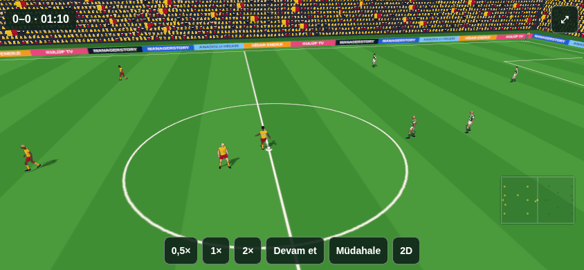
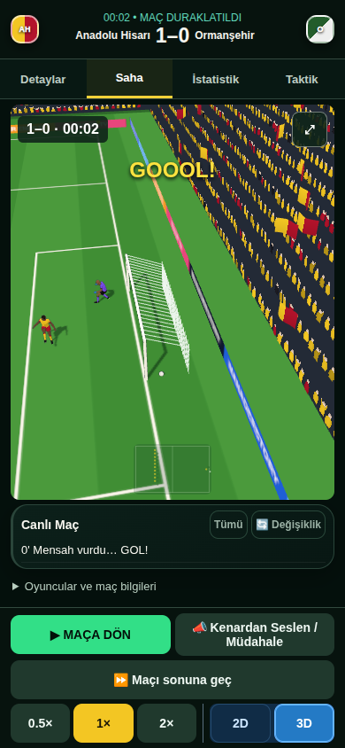

# V7.18.0 — yeni motorla kariyerde gerçek konumlu 3D

V7.19.0 notu: bu tarihli raporda açık bırakılan tam gövde kaleci uzanması/inişi/kalkışı görsel katmanda uygulanmıştır; [kaleci animasyon raporu](match-sim-keeper-animation-report.md). Çekirdeğin fiziksel erişim ve kök/top sözleşmesi aynen korunur. Aşağıdaki V7.18.0 ölçümleri tarihidir.

Kariyerde **Saha → 3D**, deneysel motorun aynı aktif maçını gösterir. 2D/3D seçimi yeni maç başlatmaz; saat, skor, kadro ve RNG korunur. Deneysel anahtar varsayılan kapalıdır. Başlangıç main `75eb294`; oyun kodu `d1ad835085a242ae5285069934a9bb5e465b54c0`, dal `feat/match-sim-3d`. Fiziksel iPhone/Safari onayı verilmemiştir.

## Bağlantı ve salt okuma sınırı

Tek sürücü `liveFrameStep → advanceExperimentalSimulation` olarak kalır. 3D'nin ikinci motor adımı veya RAF simülasyon döngüsü yoktur. `presentation.simulation3d` küçük, ayrı bağlantıdır; eski `createDirector` bu yolun futbol kaynağı değildir. Eski motor açıkken mevcut 3D yolu korunur.

Mevcut `createRuntime` yalnız oyuncu modeli kurmak ve pozlamak için kullanılır. `move`, `stepBall`, `contacts`, `place`, `kickWarp`, `planDive`, topu ele alma ve sonuç üretme yolları çağrılmaz. Gerçek rig testi bu yöntemlere girilirse hata verir; dondurulmuş çizim örnekleriyle çalışır ve çizimden sonra checkpoint/RNG eşitliğini denetler. Oyuncu, forma, kaleci ve stadyum modeli yenilenmemiştir.

`captureSimulationFrame` bağımsız kopyası hız, heading, takım yönü, yuva, rol/gait/motionMode, müdahale/kaleci durumu ve yakın gerçek temasları taşır. Topun konumu, yüksekliği, hızı, sahibi, elde tutan kaleci ve şut bilgisi çekirdektendir. Sahne kendi pasını, kurtarışını veya golünü üretmez.

| Çekirdek | Sahne |
|---|---|
| Oyuncu metre konumu `(x,y)` | Kök `(x,0,y)` |
| Top konumu `(x,y)`, zemin üstü yükseklik `h` | Top merkezi `(x,h+0,11,y)` |
| Fizik heading | Rig heading `π/2-heading` |
| Takım yönü ve ikinci yarı | İkinci kez aynalama yapılmaz; çekirdekteki konum/yön kullanılır |
| `physicsTime` | Hareket, ayak çevrimi, gerçek temas/kaleci pozu |
| `matchTime` | Ekran saati ve olay etiketi |

`scene-frame.js` yalnız gözlenmiş iki fizik karesi arasında ara konum üretir; geleceğe kestirim yoktur. Fizik ilerlemeyen RAF karesi önceki fizik karesini silmez. Duraklamada güncel kare gösterilir; devam ederken çizim saati geri gitmez. Ayak çevrimi gerçek mesafe ve fizik süresini kullanır. Kırmızı kart, sakatlık ve değişiklikte sahnedeki modeller gerçek aktif kadroyu izler; radar aynı konum örneğini okur.

Kaleci hazır duruşu ve uzanması gerçek keeper durumu, tepki/target ve bakış yönüne bağlıdır; iki hücum yönünde ellerin tehdide uzanması gerçek kemik konumuyla testlidir. Oyuncu kökü veya top, bir animasyon temasını tamamlamak için kaydırılmaz. Yıldız tekrarı üretilmez. Temel gol bildirimi gerçek gol olayından; skor, kariyer özeti ve arşiv mevcut kariyer akışındandır.

## Saat, kamera, kontroller ve kayıt

Ayarlar'daki 3/5/7/10 dakika iki görünüm için ortaktır; maç öncesinde yeniden süre sorulmaz. Yeni doğal maçlarda 1× sabit fizik temposudur. Manuel 0,5×/1×/2×, duraklatma ve mevcut müdahale kontrolleri ortak sürücüyü kullanır. Eski cihazın bağımsız oyuncu/top hızı, şut ağır çekimi ve tekrar ayarları yeni yolda okunmaz. Önceki referans saatli yarım maçların mevcut ortak modeli korunur.

Taktik görülen motor adımına uygulanır; oyuncu değişikliği ilk gerçek futbol duruşunu bekler. Kayıt biçimi 5 ve fizik checkpoint alanları değişmez. Eski çizim önbellekleri yüklemede checkpoint'ten yeniden türetilir; kesirli birikim, cursor, saat ve RNG korunur. WebGL/yükleme kaybında açıklamayla aynı maça 2D'de devam edilir. Kariyer açılmadan önceki 3D dosyası indirme hatası da sonraki seçim için hatırlanır; hata açıklaması kayda eklenmez.

Mevcut yan tribün/yayın kamerası kullanılır. Gerçek hücum yaklaşımında top, hedef kalenin direkleri/üst çizgisi ve kaleci için görüş zarfı kurulur. Dikey telefonda aşırı geniş açı yerine yayın kamerasının yüksekliği en-boy oranına uyar. Tam ekran gerçek viewport'u kaplar; sonradan gelen eski CSS bunu bozamaz. Çizim açıkça hızlı geçiliyorsa ağır sahne çizilmez, saat ve hesaplama etiketi güncellenir; bütün fizik adımları yine işlenir. Durma/bitiş veya görünümden dönüşte kamera güncel gerçek kareye kurulur. Normal canlı kameranın yumuşak takibi korunur.

## Görsel kanıtlar

[Son adayın Actions koşusu](https://github.com/rasimoner/ManagerStory/actions/runs/41034255883), Node 22.23.4 ve gerçek WebGL/Chromium ile 390×844 dokunmatik görünümde çalıştı. Yatay tam ekran ayrıca 844×390 olarak ölçüldü. Bütün fotoğraflar aynı oyun kodundandır. Görüntüler ve ham [doğrulama JSON'u](measurements/match-sim-3d/verification.json), [kaynak/hash manifesti](measurements/match-sim-3d/source.json) içinde doğrulanmıştır. Actions arşiv SHA-256: `4aec3bbcd6991d7ab2cb83329f4b6ed947fcc4f3d10db208464a83a2a2548287`.

| Senaryo | Fizik adımı / saniye | Görüntü |
|---|---:|---|
| Santra | 0 / 0 | [kickoff.png](measurements/match-sim-3d/kickoff.png) |
| Gerçek pas ve canlı hareket | 55 / 5,5 | [passing.png](measurements/match-sim-3d/passing.png) |
| Gerçek şut | 577 / 57,7 | [shot.png](measurements/match-sim-3d/shot.png) |
| Gerçek kurtarış | 708 / 70,8 | [save.png](measurements/match-sim-3d/save.png) |
| İzole test golü | 2 / 0,2 | [goal.png](measurements/match-sim-3d/goal.png) |
| Devre / ikinci yarı | Gerçek devre checkpoint'i | [Devre](measurements/match-sim-3d/half-time.png), [ikinci yarı](measurements/match-sim-3d/second-half.png) |
| 90:00 / sonuna geç | 4.200 / 420 | [full-time.png](measurements/match-sim-3d/full-time.png) |
| Tam ekran ve yatay telefon | 844×390 | [landscape-fullscreen.png](measurements/match-sim-3d/landscape-fullscreen.png) |
| WebGL bağlam kaybı | Aynı checkpoint, açıklamalı 2D | [webgl-fallback.png](measurements/match-sim-3d/webgl-fallback.png) |

Santra/pas/şut/kurtarış fotoğrafları sabit bir olağan kariyer tohumunun gerçek olaylarıdır. Gol fotoğrafı çekirdeğin kale çizgisi kabul testindeki izole geometriden üretilir; ürün maçlarında sonuç zorlayan bayrak, seçilmiş gol tohumu veya yeni futbol kuralı yoktur.

## Kontroller

Önce dört bağlantı/sözleşme testi kırmızı çalıştı; uygulama sonrası geçti. Kariyer seçimi, yükleme hatası ve iki yönde kaleci uzanması için kırmızı sonuçlar da gözlendi. Altın dosyalar değiştirilmedi; lint tabanı büyümedi.

- Aynı tohum ve aynı fizik adımı komutlarıyla tamamlanan 2D/3D maçlarının bütün checkpoint'i, olayları, skoru, kadrosu ve RNG'si eşit.
- Görünüm geçişi ek motor adımı veya saat sıçraması üretmiyor. Kaydet/devam ve eski önbellek yeniden kurma testli.
- Gerçek rig; salt okuma, aktif kadro, kırmızı/sakatlık/değişiklik, doğal kaleci beklemesi ve iki yönde gerçek el uzanması testli.
- Koordinat/yükseklik dönüşümü ve iki yön/üç en-boy oranında şut kadrajı testli.
- WebGL dumanı; gerçek tick yüklenmesi, canvas yüksekliği, gerçek tam ekran boyutu, eski hız tercihinin etkisizliği, manuel hız, duraklatma, reload, devre, 90:00, sonuna geç ve bağlam kaybını denetliyor. Sonuna geç sonrası aşırı geniş kamera açısı ayrıca reddediliyor.

Yerel Node 22.23.4: lint, **406 başarılı hızlı test / 1 mevcut atlama**, ayrı **5/5 performans**, **15 odaklı 3D test** ve build geçti. Yerel bulut tarayıcı WebGL oluşturamadığı için burada yalnız aynı maça açıklamalı 2D geri dönüşü gözlendi; gerçek 3D incelemesi yukarıdaki Actions işindedir. **Son CI doğrulaması başarılıdır:** [Actions 41034255883](https://github.com/rasimoner/ManagerStory/actions/runs/41034255883), oyun kodu `d1ad835`. Hızlı pakette 406 başarılı / 1 mevcut atlama, tam pakette 496 başarılı / 1 mevcut atlama; her iki paketin ayrı performans kapıları 5/5. Lint, build, 12 mevcut duman, bütün laboratuvarlar, eski 3D/offline/arşiv ve kariyer kontrolleri ile ayrı gerçek-WebGL 3D işi geçti. Ek denge/süre taramaları çalıştırılmadı. Yayın kapısı [Pages iş akışıdır](https://github.com/rasimoner/ManagerStory/actions/workflows/pages.yml).

Yeni denge taraması, 200 maç ölçümü veya ikinci tam yedi dakikalık izleme yapılmadı. Bütün mevcut lint, test, performans, build ve duman kapıları korunur; kısa gerçek-WebGL işi uzun doğrulamadan önce zorunludur. Yayın aynı kapıları tekrar uygular. Dal silinmez.

## Kalan sınırlar

- Genel pas/şut klipleri her vuruşta anatomik ayak–top temasını garanti etmez. Teması tamamlamak için kök veya top kaydırılmaz.
- Motor kalecinin gerçek konumunu, tepki/erişim durumunu ve kurtarış temasını verir; tam gövde plonjon/kalkış yörüngesi vermez. Mevcut uzanma pozu kullanılır; el–top hizası her kurtarışta birebir değildir.
- Kayma ve elden dağıtım mevcut kliplerle gerçek eyleme bağlanır. Blok/yönlü müdahalede genel uzanma pozu vardır; özel çalım/kurtarış hareketi eklenmez.
- Çizim bir gözlenmiş fizik karesi aralığı geride örneklenebilir; ileri kestirim yoktur. Bütçe yetmezse fizik atlanmaz, izleme uzayabilir.
- Kontrol edilen kadrajlarda boş dış alan görülmedi. Bütün olası pozisyonların veya fiziksel iPhone/Safari'nin görsel onayı verilmemiştir. Chromium emülasyonu cihazın termal yükü veya kare hızı garantisi değildir.
