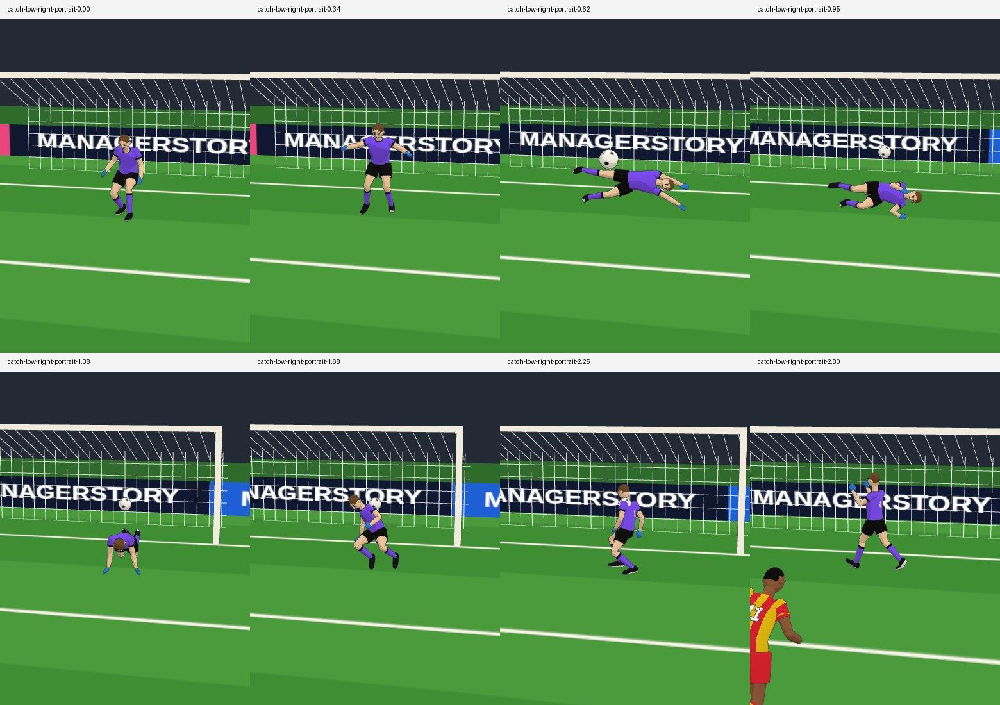

# Yeni motorun 3D kaleci animasyonu — V7.19.0

Başlangıç main `214f7e9ed4ed76e91d298a79c50e16fbf6180e16` (V7.18.0); dal `feat/match-sim-keeper-animation`. Son oyun kodu `a644bfaae896cfed0c060045cf173bdd98911155`; doğrulama adayı `ecf6bd5423531576feb5d4cf59f5ef81062c405d`. Sonraki fark yalnız test betiğidir; `src`, `package.json` ve kilit dosyası birebir aynıdır. Fiziksel iPhone/Safari testi yapılmadı.

## Teşhis ve uygulama

V7.18 `scene-actors.js/poseKeeperReach`, gerçek `dive` ve `reactionAt` sınırından sonra mevcut dalış eylemini yalnız temas pozuna kadar uygular. Gövdeyi yana yatıran, yere indiren veya kalkışı sürdüren zincir yoktur. Eski `planDive/updateDive/startRise` bu zinciri ve fiziksel kök/top hareketini birlikte yönetir. Bunlar yeni motor yoluna bağlanmadı. Eski `keeper-getup.test.cjs` ile yüzüstü kalkış korumaları değiştirilmedi.

Yeni `keeper-animation.js`, mevcut `diveRight/diveLeft` kemik pozlarını, yan iniş/destek pozlarını ve mevcut `gkGetUp` klibinin çömelmeden ayağa kalkış bölümünü kullanır. Kalça, omurga, omuz/kol, dirsek, diz ve ayak aynı eğride çalışır. Modelin kökü motorun gerçek metre konumunda kalır; yalnız kemikler pozlanır. Çim payı kemik hacimleriyle ve gerçek deforme krampon/ayakkabı yüzeyiyle ölçülür. Yeni model veya özel kurtarış yoktur.

İlk WebGL dizisi iki ek düzeltmeyi ortaya çıkardı: top geçince motorun değişen bakışı havadaki gövdeyi ters tarafa çevirmemeli; dar test kadrajı da yerdeki toparlanmayı kesmemeli. Gövdenin dalış ekseni gerçek takım/kaleci-hedef yönünde tutulur, kalkışta güncel bakışa yumuşak döner. Açısal fark en kısa yaydan alınır. Test kamerası gerçek kökü izler; ürün kamerasına bu yakın çekim ayarı taşınmaz.

İtiş 0,12 sn, uzanma 0,30 sn, iniş 0,30 sn, yerde sönüm 0,14 sn; el/diz desteğine geçiş 0,36 sn, ağırlık aktarımı 0,42 sn, kayıtlı ayağa kalkış 0,68 sn, normal duruşa karışım 0,20 sn. Toplam 2,52 fizik saniyesi. Bu süreler ve bütün ayarlanabilir poz/zemin değerleri `data/match-sim-keeper-animation.json` içindedir. Yakın topun erişim eşiği mevcut motorun `stepReach` değeridir; yeni fizik eşiği eklenmez.

## Salt okuma ve zaman sınırı

Çekirdek fizik/kaleci/gol hesabı, RNG, olay günlüğü ve checkpoint değişmez. `captureKeeperPresentation`, bağımsız çizim kopyasına kısa ufukta zaten gözlenmiş önceki `save` geometrisini ve tepki öncesi gerçekten bitmiş şutun zamanını ekler. İlerideki kurtarış, şutun sonradan tamamlanan başarı alanı veya hedef sonuç okunmaz. Ara fizik karesinde henüz gözlenmemiş kaleci durumuna geçilmez.

Her poz mutlak fizik zamanında örneklenir. Çizim fazı, kare sayacı veya ayrı duvar saati yoktur; önbellek yalnız kayıtlı klip örnekleyicileridir. İkinci şutta yerdeki önceki tepki yeni uzanmaya karışır; gerçek dağıtım kendi klibine geçer. Duraklatma, hız değişimi, 2D/3D, kaydet/devam, geriye/ileri atlayan çizim ve uzun hızlı geçiş eski dalış fazı biriktiremez. Kayıt biçimi 5 kalır; çizim örnekleri checkpoint'ten yeniden kurulur.

İlk topa atılan gerçek adım, kurtarış anındaki enine mesafeyi kısaltabilir. İkinci şutta eski plonjonun kısa uzanmaya dönüşmemesi için bağımsız kopya, ilk şutun zaten kaydedilmiş `keeper.lateralDistance` değerini de taşır. Çizim yeni erişim hesabı veya geçmiş sonuca yazma yapmaz. Temel yürüyüş/set geçişleri fiziksel hız ve `setSeconds` ile karışır; mutlak klip fazı gerçek mesafeden gelir.

## Testler

Önce yedi odaklı test çalıştı: altısı eski V7.18 davranışında kırmızıydı. İkinci şutta yere yatmış modelin bir karede ayağa dönmesini yakalayan ek test de önce kırmızı çalıştı. Gerçek rig kemiklerinin dünya konumları, bütün deforme model yüzeyinin zemini kesmemesi ve ardışık örnekler arasındaki mesafe sınırları denetlenir; yalnız faz adı veya kaynak metni aranmaz.

İki yön/iki kale/iki devre, alçak/yüksek/çok yakın top, tepki sınırı, başarısız dalışın inişi/kalkışı, ikinci şut ve gerçek dağıtım; 0,5×/1×/2× eşdeğeri kare aralıklarında, aynı fizik anında ve sıfırdan kurulmuş sahnede aynı kemikler korunur. Gerçek çekirdeğin tutma/çelme/boşa dalış senaryolarında çizim öncesi/sonrası tam checkpoint/olay/RNG eşitliği ayrıca test edilir. Eski kaleci, genel 3D, iki görünümün aynı komutlarla aynı sonuca ulaşması ve bütün zorunlu kapılar korunur.

Ek kırmızı testler gerçek bakış değişiminde ters yöne dönen dalışı ve ilk temasa adım atmış kalecinin ikinci şutta ayağa sıçramasını yakaladı. Gerçek dört kaydın 120 Hz ara çiziminde kemiklerin dünya konumları da karşılaştırılır; motorun meşru kök yer değiştirmesi çıkarıldıktan sonraki beden farkı sınırlıdır. Böylece motorun hızını değiştirmek yerine sunumdaki kopma ölçülür.

İlk uygulama commit'i `12706ed`: Node 22.23.4, lint, 414 hızlı test / 1 mevcut atlama, ayrı 5/5 performans kapısı geçti. Son adayın yerel Node 22.23.4 kontrolünde lint, **421 hızlı / 511 tam test**, her pakette **1 mevcut atlama**, ayrı performans kapıları **5/5** ve build geçti. Tam işlev paketi 261,7 sn, ardından beş performans kapısı 11,4 sn sürdü. Yeni sezon, geniş denge veya süre taraması başlatılmadı; mevcut performans kapıları aynen korunur.

## Görsel kanıt yöntemi

Yerel Chromium kurulu değil; gerçek WebGL incelemesi mevcut Actions yoluna eklenen sınırlı `smoke:keeper-animation` ile yapılır. 390×844 dikey ve 844×390 yatay görünümde beş sabit izole çekirdek geometrisi: alçak sağ tutma, alçak sol çelme, karşı kalede yüksek çelme, boşa dalış ve yakın topa adım. Her sonucun sahibi değiştirilmemiş çekirdektir. Normal kariyere bu geometriler veya sonuç zorlayan seçenekler eklenmez.

Olağan kariyer kanıtı ayrı sınıftır: mevcut sabit kariyer salt'ı 73, gerçek 69–73,5 fizik saniyesi. Model/kök/top veya olay değiştirilmez; gerçek kariyer UI'si kullanılır. Tam hareket videoları, sekiz ardışık kare, WebGL sürümü, dünya kemik konumları, kaynak commit'i ve gerçek olay zamanları arşivlenir. Tek kurtarış fotoğrafıyla görsel kabul verilmez.

[Oyun kodu a644bfa için başarılı WebGL işi](https://github.com/rasimoner/ManagerStory/actions/runs/41090848302/job/124184016969), 390×844 ve 844×390 olarak **12/12 kayıt** üretti. [Ham videolar ve tam PNG kareleri](https://github.com/rasimoner/ManagerStory/actions/runs/41090848302/artifacts/12994691790), [ham kemik/olay verisi](measurements/match-sim-keeper-animation/verification.json) ve [kaynak/hash manifesti](measurements/match-sim-keeper-animation/source.json). Arşiv SHA-256 `a045a4b1d73ccf29ba9a84ab5b6b2fd5a555cb5d2f572ab550e97e0a738da3ee`.

Son doğrulama adayının [WebGL işi de geçti](https://github.com/rasimoner/ManagerStory/actions/runs/41093423205/job/124193494481): **12/12**. İki bağımsız gerçek WebGL koşusunun aynı fizik zamanındaki **80 izole örneğinde bütün dünya kemik konumları birebir aynı**. Bu, farklı çizim yükünde pozu tekrar üretmenin ek kanıtıdır; telefonda kare hızı ölçümü değildir. Son arşiv SHA-256 `541d79658cbde7c96af5718e337950788e8199956fcd807785103aef7839dc09`; [son videolar](https://github.com/rasimoner/ManagerStory/actions/runs/41093423205/artifacts/12995711326).

| Kanıt türü | Sonuç | Ardışık kareler |
|---|---|---|
| İzole, alçak sağ | Çekirdeğin gerçek tutması; iniş/destek/kalkış | [8 kare](measurements/match-sim-keeper-animation/catch-low-right.jpg) |
| İzole, alçak sol | Çekirdeğin gerçek çelmesi | [8 kare](measurements/match-sim-keeper-animation/parry-low-left.jpg) |
| İzole, karşı kale/yüksek | Yüksek uzanma ve çelme | [8 kare](measurements/match-sim-keeper-animation/parry-high-other-goal.jpg) |
| İzole, boşa dalış | Gerçek gol; başarısız dalıştan toparlanma | [8 kare](measurements/match-sim-keeper-animation/miss-low-left.jpg) |
| İzole, yakın top | Ayakta kısa uzanma; tam plonjon yok | [8 kare](measurements/match-sim-keeper-animation/near-step.jpg) |
| Olağan kariyer | Gerçek UI, gerçek şut/kurtarış ve devamı | [Dikey](measurements/match-sim-keeper-animation/ordinary-portrait.jpg) · [Yatay](measurements/match-sim-keeper-animation/ordinary-landscape.jpg) |

Kare dizileri özgün PNG'lerin sıralı kırpılmış JPEG bileşimidir; oyuncu görüntüsü üretilmedi veya rötuşlanmadı. Olağan kariyer dizileri özgün WebM'den alınır. Kaynak görüntüler ve bütün video arşivdedir. Yazılımsal SwiftShader çizimi yavaştır: videonun duvar süresi, gösterdiği 3,5–5 fizik saniyesinden uzundur. Bu kayıtlar gerçek cihazda 1× süre/FPS garantisi veya fiziksel iPhone/Safari görsel onayı değildir. Test bekçisi toplam videoya süre kotası koymaz; fizik saatinin ilerlemesini denetler.

## Son doğrulama ve yayın

[Son Node 22 koşusu](https://github.com/rasimoner/ManagerStory/actions/runs/41093423205) bütünüyle başarılıdır: lint; **421 hızlı / 511 tam test**, her pakette **1 mevcut atlama**, her iki paketin ayrı performans kapıları **5/5**; build; eski 3D/offline/arşiv kontrolleri, laboratuvarlar ve kariyer dahil bütün mevcut `smoke`; ayrıca `smoke:sim-3d` ve iki telefon yönünde **12/12** kaleci kaydı geçti. Test eşiği veya zorunlu kontrol kaldırılmadı; yalnız bu işin kapsamı dışındaki ek geniş denge/süre taramaları ve ikinci yedi dakikalık izleme başlatılmadı. Altın dosyalar değişmedi, lint tabanı büyümedi.

Yayın kapısı [Pages iş akışıdır](https://github.com/rasimoner/ManagerStory/actions/workflows/pages.yml); main'de tam test/build/mevcut smoke ve 3D kontrolünü yeniden uygular. Birleşme SHA'sı ve başarılı yayın koşusu teslim mesajında ayrıca verilir. Dal korunur; birleşme sonrası `feat/match-sim-keeper-animation` silinebilecek adaydır.

## Telefonda deneme

1. Canlı oyunda V7.19.0'ı doğrula. Ayarlar'da deneysel motoru aç; kariyer maçında Saha → 3D seç.
2. Uzak alçak/yüksek şutta gövdenin yana uzandığını, inişin sönümlendiğini ve el/diz desteğiyle kalktığını izle. Sağ/sol ve ikinci yarı yönünü karşılaştır.
3. Yakın topa her seferinde plonjon olmamalı. Tutma, çelme veya gol sonucu hareketten bağımsız motor olayıdır; boşa dalan da kalkmalı.
4. Kurtarış çevresinde 0,5×/1×/2×, duraklatma, 2D↔3D ve kaydet/devam dene. Dönen topa ikinci şut veya dağıtım geldiğinde eski hareket takılı kalmamalı.

## Sınırlar

Motor kalecinin gövde dalış yörüngesini fiziksel olarak simüle etmez. Görsel plonjon gerçek erişim zarfını büyütmez; el–top anatomik hizası bütün temaslarda garanti değildir. Özellikle elde topun fiziksel taşıma yüksekliği/kök konumu korunur; topu elde tutturmak için sahnede kaydırılmaz. Son fizik durumundan yeniden kurma sırasında önceki tepkinin kaynağı gerçek kurtarış geometrisidir; tam geçmiş beden yörüngesi checkpoint'e eklenmez. Özel kurtarışlar, saha oyuncuları ve eksik futbol kuralları kapsam dışıdır.
